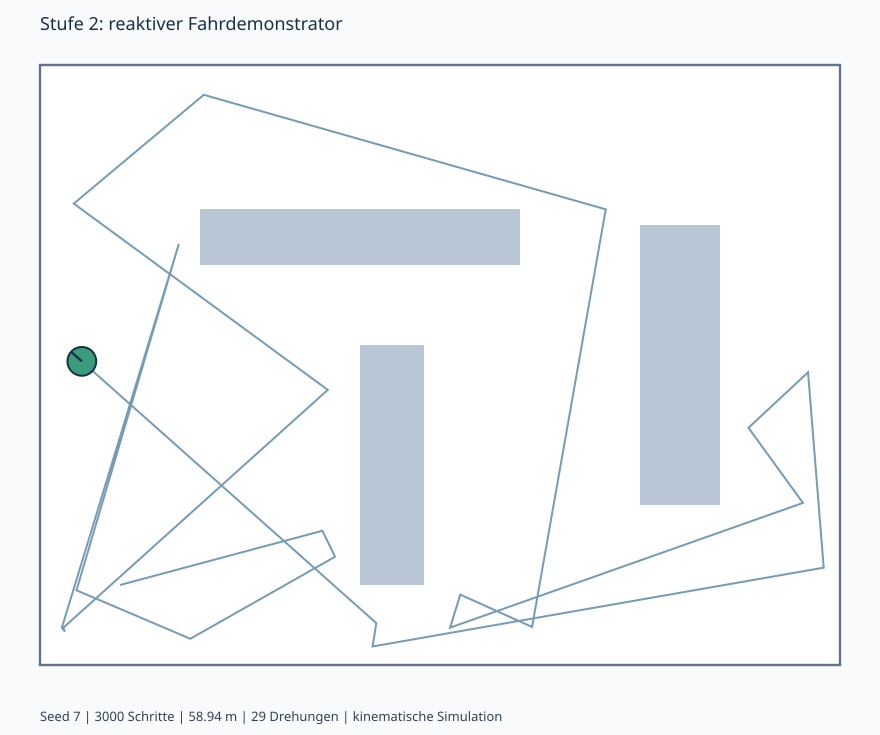

# Stufe 2: minimaler reaktiver Fahrroboter

Diese Stufe fuehrt noch keinen Materialtransport aus. Sie demonstriert den
kleinen geschlossenen Regelkreis Wahrnehmen -> Entscheiden -> Bewegen ->
erneut Wahrnehmen. Das spaetere Transportziel und seine Anforderungen bleiben
im Gesamtmodell erhalten.

## Start unter Windows

Im Hauptverzeichnis des Repositorys, neben `README.md`:

```powershell
py -3 -m robot_demo
```

Alternativ, wenn Python als `python` aufgerufen wird:

```powershell
python -m robot_demo
```

Python 3.10 oder neuer mit Turtle/Tk genuegt. Keine pip-Pakete und kein ROS 2
sind fuer diesen Fahrdemonstrator erforderlich. Python von python.org bringt
unter Windows ueblicherweise Tk mit. Vorab pruefen: `py -3 -m tkinter`.
Unter Ubuntu/Debian kann Tk separat als `python3-tk` benoetigt werden.
Die SysML-Validierung ist davon unabhaengig und verwendet weiterhin Java 21.

Bedienung:

| Taste | Wirkung |
| --- | --- |
| Leertaste | Pausieren; Operation und bereits begonnene Drehung bleiben erhalten |
| Enter | Ausdruecklich manuell fortsetzen |
| R | Beispielszenario mit demselben Seed neu starten |
| Esc | Fenster schliessen |

Das Fenster muss fuer Tastatureingaben den Fokus haben.
Gruen bedeutet Geradeausfahrt, Gelb Drehung, Grau Pause. Die Linie zeigt die
idealisierte vordere Abstandserkennung; bei erkanntem Hindernis wird sie rot.
Die Bewegungsspur und die Anzahl ausgewaehlter Drehungen bleiben sichtbar.

## Verhalten

1. Bei freiem Weg geradeaus fahren.
2. Wird die konfigurierte Erkennungsdistanz unterschritten, die Translation
   stoppen und einen begrenzten zufaelligen Drehwinkel waehlen.
3. Auf der Stelle drehen, ohne gleichzeitig vorwaerts zu fahren.
4. Erst nach der vollstaendigen Drehung erneut messen. Bei freiem Weg wieder
   geradeaus; bei weiter blockiertem Weg einen neuen Zufallswinkel waehlen.
5. Waehren einer Pause weder Pose noch Zufallsfolge oder Restdrehwinkel
   veraendern. Fortsetzung nur auf die explizite Bedienhandlung.

"Hindernis" umfasst auch die Begrenzung der Zeichenflaeche. Der Demonstrator
erkennt Hindernisse vor dem Kontakt; er faehrt nicht absichtlich dagegen.
Der Zufallsfahrer kann Sackgassen mehrfach pruefen und garantiert keine
Zielerreichung oder vollstaendige Flaechenabdeckung.

## Einstellbare Beispielwerte

`robot_demo/scenario.json` enthaelt Welt, Rechtecke, Startpose, Zeitschritt,
Seed und Roboterparameter. Alle Geometrie-, Sensor- und Drehwerte sind
**Demonstrationswerte**, keine genehmigten Hardwaredaten oder neuen
Systemanforderungen. Die beispielhafte Geschwindigkeit 0,5 m/s passt zum
bisherigen Zielwert, legt dessen spaetere Toleranz aber nicht fest.

Der Seed macht einen Lauf innerhalb derselben Python-/Programmversion
reproduzierbar. Andere Zufallsfolgen sind ueber `--seed` waehlbar.
Zufallsbetraege stammen aus dem konfigurierten Intervall; das Vorzeichen
bestimmt Links-/Rechtsdrehung. Drehungen nahe null sind im Beispiel ausgeschlossen.

```powershell
py -3 -m robot_demo --seed 12
py -3 -m robot_demo --scenario robot_demo/scenario.json
```

## Wiederverwendung im Gesamtsystem

Der neue Typ `MobileRobotBase` in der bestehenden `03_structure.sysml`
enthaelt die gemeinsam nutzbaren Komponenten und ihre typisierten Verbindungen.
`MobileMaterialRobot` und `ReactiveWanderRobot` spezialisieren diese Basis.
Damit ist der Fahrdemonstrator keine Kopie des gesamten Transportroboters.

| Rolle im bestehenden Modell | Python-Baustein | Spaeterer Austausch |
| --- | --- | --- |
| PerceptionSystem | RangeSensor-Protokoll / SimulatedRangeSensor | Reale Sensorik oder physikalischer Simulator |
| NavigationSystem | RandomTurnNavigator | Zielnavigation / ROS2-Adapter |
| MotionSystem | KinematicDrive / VelocityCommand | Antriebs- oder Simulationsadapter |
| SafetySystem | Simulations-Kollisionsschutz und manuelle Freigaberegel | Eigenstaendiges Sicherheitskonzept |
| DiagnosticsSystem | Laufzaehler, Status und Spur | Persistente Logs / Web-Status |
| Anzeigeadapter ausserhalb des Roboters | TurtleViewer / SVG-Ausgabe | Realistische 3D-Visualisierung |

Der Navigator erhaelt nur eine Sensorablesung und den Zeitschritt. Er kennt
weder die Weltgeometrie noch die wahre Pose. Weltwissen verwenden ausschliesslich
simulierte Sensorik, Bewegungskontrolle und Visualisierung.
MissionSystem, TransportSystem, Traeger, Laden und Web-App werden in der
reaktiven Variante nicht instanziiert. Ihre bisherigen Modelle bleiben vorhanden.

## Was simuliert wird

- Kreisfoermiger Roboter auf einer ebenen Flaeche, Position und Orientierung.
- Geradeausfahrt und Drehung auf der Stelle mit kinematischen Geschwindigkeiten.
- Rechteckige Hindernisse, Waende und eine ideale Abstandserkennung fuer die
  gesamte vorwaerts bewegte Roboterkontur, kein konkreter LiDAR.
- Kontinuierliche Pruefung des befahrenen Weges, damit auch ein grosser
  Zeitschritt keine duenne Wand ueberspringt.

Nicht enthalten sind Motoren, Traegheit, Beschleunigung/Bremsvorgaenge,
Reibung, Schlupf, Kontaktkraefte, reale Sensorfehler und Personen-Sicherheit.
Der geometrische Kollisionsschutz nutzt Simulationswissen und ist kein
Sicherheitsverfahren fuer einen realen Roboter. Diese Stufe ersetzt daher
nicht die spaeter gewuenschte physikalische und realistisch dargestellte Simulation.

## Konkreter Funktionstest

1. Mit Seed 7 starten. Der Roboter muss zuerst geradeaus fahren.
2. Am Hindernis muss die Vorwaertsbewegung enden und eine sichtbare Drehung beginnen.
3. Bleibt der Weg nach der Drehung blockiert, muss eine weitere Drehung folgen.
4. Bei freiem Weg muss wieder Geradeausfahrt folgen.
5. Mitten in einer Drehung Leertaste druecken. Position und Winkel muessen
   stehen bleiben; ohne Enter darf der Roboter nicht selbst weiterfahren.
6. Enter druecken. Die restliche Drehung wird fortgesetzt.

Automatisiert und ohne Fenster:

```powershell
py -3 -m unittest discover -s tests -v
py -3 -m robot_demo --headless --steps 3000 --seed 7 --svg trace.svg
```

Ein erwarteter Lauf mit der mitgelieferten Konfiguration: 3000 Schritte,
150 s Simulationszeit, 29 ausgewaehlte Drehungen und etwa 58,94 m Weg.
Die SVG-Datei zeigt die tatsaechlich berechneten Posen. Ohne Display wird der
Turtle-Fenstertest lokal uebersprungen; der GitHub-Test fuehrt ihn mit Xvfb aus.

Eine gespeicherte Beispielspur:



## Modell und Traceability

Den gesamten Ordner `sysml` laden; `sysml/00_project.sysml` ist die gemeinsame
Zusammenstellung. `stage2_wander` enthaelt Requirements, Verhalten, Architektur,
Verifikationsfaelle und Sichten. Die sechs synthetischen Modellbeispiele pruefen
die Kriterien getrennt von den Python-Integrationstests. Sie sind keine
Beobachtungen eines realen Roboters.

| Anforderung | Modelltest | Python-Nachweis |
| --- | --- | --- |
| REQ-WDR-001 freie Geradeausfahrt | TC_WDR_001 | Geradeaus-Befehl und Weg/Zeit-Test |
| REQ-WDR-002 Hindernis stoppt Translation | TC_WDR_002 | Erkennungstest und Kollisions-/Wandtest |
| REQ-WDR-003 Zufallswinkel / Drehen auf Stelle | TC_WDR_003 | Winkelgrenzen, Vorzeichen, Vielfalt, Drehbefehl |
| REQ-WDR-004 erneute Wahrnehmung nach Drehung | TC_WDR_004 | blockiert -> weitere Drehung; frei -> vorwaerts |
| REQ-WDR-005 Pause / manuelle Freigabe | TC_WDR_005 | Pose, RNG, Operation und Restwinkel bleiben erhalten |

In einer SysML-Visualisierung koennen `wanderArchitecture` und `wanderBehavior`
aus `03_architecture.sysml` dargestellt werden.
